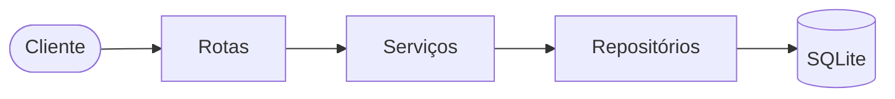

# Tasks API

API REST para gerenciar **tarefas** organizadas em **grupos**, feita em Python 3.14 com FastAPI, SQLModel e SQLite.

Cada tarefa pertence a exatamente um grupo: o grupo é criado primeiro e as tarefas nascem dentro dele. Não existe tarefa sem grupo, e um grupo só pode ser excluído quando está vazio.

- [Estado atual](#estado-atual)
- [Instalação](#instalação)
- [Configuração](#configuração)
- [Execução](#execução)
- [Usando a API](#usando-a-api)
- [Módulos](#módulos)
- [Arquitetura](#arquitetura)
- [Testes e qualidade](#testes-e-qualidade)
- [Uso de IA no desenvolvimento](#uso-de-ia-no-desenvolvimento)
- [Limitações](#limitações)
- [Pendências e próximos passos](#pendências-e-próximos-passos)
- [Documentação do projeto](#documentação-do-projeto)

## Estado atual

Versão **v0.1.0**, que entrega a release **R1 (Core)** do [backlog](docs/02-backlog.md):

| Área | Entregue |
|---|---|
| Grupos | criar, listar (com busca e paginação), consultar, atualizar parcialmente e excluir |
| Tarefas | criar dentro de um grupo, listar por grupo, consultar, atualizar parcialmente (inclusive mover de grupo) e excluir |
| Regras | nome de grupo único (sem diferenciar maiúsculas nem acentos), status com `completed_at` definido pelo servidor, exclusão de grupo só quando vazio |
| Contrato | erros em Problem Details (RFC 9457), paginação padronizada, `GET /health`, documentação interativa em `/docs` |
| Qualidade | 764 testes, 99% de cobertura, `ruff` e `mypy` sem erros |

## Instalação

**Requisitos:** [uv](https://docs.astral.sh/uv/) e Python 3.14. O `uv` baixa e isola o Python 3.14, sem alterar as versões que você já tenha instaladas.

Desenvolvido e testado em **Windows**. O código foi escrito para ser portável a **Linux**, mas a execução em Linux não foi testada.

**1. Instale o `uv`** (uma vez)

```powershell
# Windows (PowerShell)
winget install --id=astral-sh.uv -e
```

```bash
# Linux / macOS
curl -LsSf https://astral.sh/uv/install.sh | sh
```

Feche e reabra o terminal e confirme com `uv --version`.

**2. Instale o projeto**

```bash
cd tasks-api        # a pasta do projeto
uv sync             # cria o .venv com Python 3.14 e instala as dependências
```

O `uv sync` usa o `uv.lock`, então todos instalam exatamente as mesmas versões. As dependências também estão listadas em [requirements.txt](requirements.txt) (`uv pip install -r requirements.txt`), mantido com as mesmas versões.

Mais detalhes sobre o Python em [docs/PYTHON.md](docs/PYTHON.md).

## Configuração

Toda a configuração vem de variáveis de ambiente com o prefixo `TASKS_`, lidas também de um arquivo `.env` na pasta onde a API é iniciada. Sem nenhuma configuração, os valores padrão funcionam.

| Variável | Padrão | Descrição |
|---|---|---|
| `TASKS_DATABASE_URL` | `sqlite:///./tasks.db` | URL do banco (SQLAlchemy) |
| `TASKS_LOG_LEVEL` | `INFO` | `DEBUG`, `INFO`, `WARNING`, `ERROR` ou `CRITICAL` |
| `TASKS_HOST` | `127.0.0.1` | Endereço em que o servidor escuta |
| `TASKS_PORT` | `8000` | Porta (1 a 65535) |

Para personalizar, copie o modelo e edite:

```powershell
Copy-Item .env.example .env      # Windows
```
```bash
cp .env.example .env             # Linux / macOS
```

Um valor inválido (porta fora da faixa, nível de log desconhecido, URL vazia) impede a API de iniciar, com uma mensagem indicando o campo. O arquivo `.env` não vai para o Git; só o `.env.example` é versionado.

## Execução

```bash
uv run python -m app
```

A API sobe em `http://127.0.0.1:8000` e cria as tabelas do banco na primeira execução (o arquivo `tasks.db` aparece na pasta atual). Se não conseguir preparar o banco, por exemplo com um caminho em pasta inexistente, ela se recusa a iniciar.

| Endereço | Para quê |
|---|---|
| `http://127.0.0.1:8000/docs` | Documentação interativa (Swagger UI), onde dá para testar os endpoints |
| `http://127.0.0.1:8000/openapi.json` | Especificação OpenAPI |
| `http://127.0.0.1:8000/health` | Verificação de saúde da API e do banco |

Também é possível chamar o `uvicorn` direto; nesse caso host e porta vêm dos parâmetros dele, e não das variáveis `TASKS_HOST` e `TASKS_PORT`:

```bash
uv run uvicorn app.main:create_app --factory --port 8000
```

## Usando a API

Todos os endpoints de negócio ficam sob **`/api/v1`**. Corpos e respostas são JSON em UTF-8; datas de vencimento usam `YYYY-MM-DD` e os horários são ISO 8601 em UTC (`2026-10-17T20:23:56Z`).

### Endpoints

| Método e caminho | Descrição | Sucesso |
|---|---|---|
| `POST /task-groups` | Cria um grupo | `201` + `Location` |
| `GET /task-groups` | Lista grupos (`q`, `page`, `page_size`) | `200` |
| `GET /task-groups/{id}` | Consulta um grupo | `200` |
| `PATCH /task-groups/{id}` | Atualiza `name` e/ou `description` | `200` |
| `DELETE /task-groups/{id}` | Exclui um grupo vazio | `204` |
| `POST /task-groups/{group_id}/tasks` | Cria uma tarefa no grupo | `201` + `Location` |
| `GET /task-groups/{group_id}/tasks` | Lista as tarefas do grupo (`page`, `page_size`) | `200` |
| `GET /tasks/{id}` | Consulta uma tarefa | `200` |
| `PATCH /tasks/{id}` | Atualiza campos da tarefa; `task_group_id` move de grupo | `200` |
| `DELETE /tasks/{id}` | Exclui a tarefa | `204` |
| `GET /health` | Saúde da API e do banco (fora do `/api/v1`) | `200` |

Não há `PUT`: a edição é sempre parcial, por `PATCH`.

### Dados

**Grupo (`TaskGroup`)**

| Campo | Regras |
|---|---|
| `id` | UUID gerado pelo servidor |
| `name` | obrigatório, 1 a 100 caracteres, **único** sem diferenciar maiúsculas, acentos em caixa diferente nem espaços nas pontas |
| `description` | opcional, até 500 caracteres |
| `created_at`, `updated_at` | gerados pelo servidor |

**Tarefa (`Task`)**

| Campo | Regras |
|---|---|
| `id`, `task_group_id` | UUIDs; o grupo vem do caminho na criação |
| `title` | obrigatório, 1 a 200 caracteres |
| `description` | opcional, até 2000 caracteres |
| `status` | `pending` (padrão), `in_progress` ou `completed`; qualquer transição é permitida |
| `priority` | `low`, `medium` (padrão) ou `high` |
| `due_date` | opcional, `YYYY-MM-DD` |
| `created_at`, `updated_at` | gerados pelo servidor |
| `completed_at` | definido pelo servidor: preenchido ao concluir, apagado ao reabrir |

Campos gerados pelo servidor (`id`, `created_at`, `updated_at`, `completed_at`) enviados no corpo são ignorados; qualquer outro campo desconhecido é rejeitado com `422`.

### Exemplo passo a passo

Com a API no ar (`uv run python -m app`), em outro terminal. Os exemplos usam `curl`, presente no Linux, no macOS e no Git Bash do Windows.

**1. Criar um grupo**

```bash
curl -i -X POST http://127.0.0.1:8000/api/v1/task-groups \
  -H "Content-Type: application/json" \
  -d '{"name": "Work", "description": "Everything for the job"}'
```
```text
HTTP/1.1 201 Created
location: /api/v1/task-groups/62a677c3-13ba-4a96-be11-3d7599909af2

{"id":"62a677c3-13ba-4a96-be11-3d7599909af2","name":"Work","description":"Everything for the job","created_at":"2026-10-17T20:23:56.650978Z","updated_at":"2026-10-17T20:23:56.650978Z"}
```

**2. Criar uma tarefa no grupo** (troque pelo `id` recebido)

```bash
curl -X POST http://127.0.0.1:8000/api/v1/task-groups/62a677c3-13ba-4a96-be11-3d7599909af2/tasks \
  -H "Content-Type: application/json" \
  -d '{"title": "Write report", "priority": "high", "due_date": "2026-12-31"}'
```
```json
{"id":"2afe2e8e-5fba-43b8-8789-55a18a3435dc","task_group_id":"62a677c3-13ba-4a96-be11-3d7599909af2","title":"Write report","description":null,"status":"pending","priority":"high","due_date":"2026-12-31","created_at":"2026-10-17T20:23:56.927647Z","updated_at":"2026-10-17T20:23:56.927647Z","completed_at":null}
```

**3. Listar as tarefas do grupo**

```bash
curl "http://127.0.0.1:8000/api/v1/task-groups/62a677c3-13ba-4a96-be11-3d7599909af2/tasks?page=1&page_size=10"
```
```json
{"items":[{"id":"2afe2e8e-...","title":"Write report","status":"pending","...":"..."}],"page":1,"page_size":10,"total":1}
```

**4. Concluir a tarefa**: o servidor preenche `completed_at`

```bash
curl -X PATCH http://127.0.0.1:8000/api/v1/tasks/2afe2e8e-5fba-43b8-8789-55a18a3435dc \
  -H "Content-Type: application/json" \
  -d '{"status": "completed"}'
```
```json
{"id":"2afe2e8e-...","status":"completed","updated_at":"2026-10-17T20:23:57.283294Z","completed_at":"2026-10-17T20:23:57.283180Z","...":"..."}
```

**5. Excluir** (primeiro a tarefa, depois o grupo, que precisa estar vazio)

```bash
curl -X DELETE http://127.0.0.1:8000/api/v1/tasks/2afe2e8e-5fba-43b8-8789-55a18a3435dc                # 204
curl -X DELETE http://127.0.0.1:8000/api/v1/task-groups/62a677c3-13ba-4a96-be11-3d7599909af2          # 204
```

**No PowerShell**, o mesmo fluxo pode ser feito com `Invoke-RestMethod`:

```powershell
$base = "http://127.0.0.1:8000/api/v1"
$group = Invoke-RestMethod -Method Post -Uri "$base/task-groups" -ContentType "application/json" -Body '{"name": "Work"}'
$task = Invoke-RestMethod -Method Post -Uri "$base/task-groups/$($group.id)/tasks" -ContentType "application/json" -Body '{"title": "Write report"}'
Invoke-RestMethod -Method Patch -Uri "$base/tasks/$($task.id)" -ContentType "application/json" -Body '{"status": "completed"}'
```

> Envie sempre o corpo em **UTF-8**. Alguns terminais do Windows codificam argumentos acentuados de outra forma, e a API responde `400`. Nesse caso use a página `/docs` ou um arquivo com `-d @arquivo.json`.

### Paginação e busca

As listagens devolvem `items`, `page`, `page_size` e `total`. O padrão é `page=1` e `page_size=20`, com máximo de 100. Valores fora da faixa respondem `400`.

`GET /task-groups?q=wor` filtra os grupos cujo nome contém o texto, sem diferenciar maiúsculas, acentos em caixa diferente nem espaços nas pontas. Os grupos saem ordenados por nome e as tarefas, da mais nova para a mais antiga.

### Erros

Todos os erros usam `application/problem+json` (RFC 9457), com `type`, `title`, `status`, `detail` e `instance`:

```json
{"type":"about:blank","title":"Conflict","status":409,"detail":"The task group still has tasks; delete or move them first.","instance":"/api/v1/task-groups/62a677c3-13ba-4a96-be11-3d7599909af2"}
```

| Código | Quando |
|---|---|
| `400` | JSON malformado ou parâmetro de **query** inválido (`page_size=500`) |
| `404` | Grupo ou tarefa inexistente; rota inexistente |
| `405` | Método não permitido (o cabeçalho `Allow` lista os aceitos) |
| `409` | Nome de grupo repetido; exclusão de grupo que ainda tem tarefas |
| `422` | Corpo ou parâmetro de caminho inválido: campo vazio, longo demais, desconhecido, enum ou data inválidos, `id` que não é UUID, mover tarefa para grupo inexistente |
| `500` | Erro interno, sem detalhes internos na resposta |

O `503` só aparece em `GET /health`, quando o banco está indisponível, no formato `{"status": "error", "database": "error"}`.

## Módulos

```text
app/
  __main__.py          python -m app: inicia o uvicorn com a configuração
  main.py              fábrica da aplicação (create_app) e ciclo de vida
  config.py            configuração por variáveis de ambiente (pydantic-settings)
  db.py                engine do SQLite, chaves estrangeiras ativas, criação das tabelas
  errors.py            erros de domínio (NotFoundError, ConflictError, ...)
  error_handlers.py    conversão de erros em Problem Details
  models/              tabelas (SQLModel): TaskGroup, Task e os enums
  schemas/             entrada e saída da API (Pydantic) e paginação
  repositories/        único lugar que consulta o banco
  services/            regras de negócio, sem depender do framework web
  routes/              roteadores FastAPI, finos
tests/
  unit/                serviços, repositórios, modelos, schemas, arquitetura
  integration/         cada endpoint via TestClient, fluxo de ponta a ponta, servidor real
  conftest.py          banco isolado por teste, cliente HTTP
  factories.py         fábricas de TaskGroup e Task
docs/                  escopo, backlog, arquitetura, diagramas e plano de desenvolvimento
prompts/               prompts usados para gerar a documentação e orientar a implementação
```

## Arquitetura



- **Rotas** validam a entrada (schemas Pydantic) e traduzem erros; **serviços** guardam as regras; **repositórios** são os únicos que fazem consultas. Dois testes de arquitetura vigiam essas fronteiras: serviços e repositórios não importam o framework web, e nenhuma consulta ao banco aparece fora dos repositórios.
- O **SQLModel** une o modelo de tabela e o Pydantic. O nome do grupo é comparado por uma coluna interna `normalized_name` (sem espaços nas pontas e com `casefold`) com **índice único**, porque o `lower()` do SQLite só trata ASCII. O banco é a palavra final, o que protege também contra duas requisições simultâneas.
- O SQLite vem com **chaves estrangeiras desligadas**; a API as liga em toda conexão, e é isso que garante que uma tarefa nunca fique sem grupo.
- Os erros de validação do FastAPI foram remapeados: `400` para query e `422` para corpo e caminho.

Diagramas completos (endpoints, camadas, modelo de dados e fluxos) em [docs/04-mermaid.md](docs/04-mermaid.md) e as decisões de bibliotecas em [docs/03-arquitetura-mvp.md](docs/03-arquitetura-mvp.md).

## Testes e qualidade

```bash
uv run pytest                                      # toda a suíte
uv run pytest --cov=app --cov-fail-under=80        # com cobertura (mínimo de 80%)
uv run pytest tests/unit                           # só os unitários
```

| Verificação | Comando |
|---|---|
| Formatação | `uv run ruff format .` |
| Lint (inclui regras de portabilidade) | `uv run ruff check .` |
| Tipos (modo `strict`) | `uv run mypy app` |
| Testes e cobertura | `uv run pytest --cov=app --cov-fail-under=80` |

- **764 testes, 99% de cobertura.** Cada teste usa o seu próprio banco SQLite em memória e a ordem de execução é embaralhada a cada rodada (`pytest-randomly`). Para reproduzir uma ordem: `uv run pytest -p randomly --randomly-seed=1234`.
- O **fluxo principal** (criar grupo, criar tarefas, listar, concluir, excluir tarefas e grupo) é testado de duas formas: com o cliente em processo e contra um **servidor real** iniciado com `python -m app` em um banco em arquivo.
- Há testes de contrato dos erros, das regras de negócio (uma a uma), da concorrência (oito requisições simultâneas criando o mesmo nome resultam em um `201` e sete `409`), do inventário de endpoints e da impossibilidade de criar tarefa sem grupo.
- Não há pipeline de CI: o conjunto acima é executado localmente antes de cada commit.

## Uso de IA no desenvolvimento

O projeto foi desenvolvido com o **Claude Code** (modelos Claude Opus 5.5 e Sonnet 5.5, registrados como coautores em cada commit), seguindo um processo em etapas:

1. **Prompts numerados** em [`prompts/`](prompts) descrevem cada tarefa: escopo, backlog, arquitetura e bibliotecas, diagramas, estratégia de codificação e cada etapa de implementação.
2. **A documentação é gerada antes do código**: [escopo](docs/01-escopo-mvp.md), [backlog](docs/02-backlog.md) com critérios de aceite, [arquitetura](docs/03-arquitetura-mvp.md), [diagramas](docs/04-mermaid.md) e o [plano de desenvolvimento](docs/07-passos-dev.md) com 23 etapas, testes e commits previstos.
3. **Uma revisão de riscos antes de codificar**: a IA foi usada para apontar o que estava grande demais, o que faltava em testes e os riscos técnicos; os riscos foram reproduzidos em um experimento (por exemplo, `lower()` do SQLite ignorando acentos, chaves estrangeiras desligadas por padrão e limite de corpo contornável) e o escopo foi ajustado.
4. **Implementação incremental**, uma etapa por vez, sempre com testes junto do código e os critérios de aceite do backlog marcados ao final de cada uma.

Regras de trabalho fixadas no [`CLAUDE.md`](CLAUDE.md), que a IA lê a cada sessão:

- **Aprovação humana antes de cada commit**: a IA apresenta os arquivos, a mensagem e o resultado da verificação, e só commita depois de um "sim". Nenhum `push` é feito sem pedido.
- **Commits atômicos** no padrão Conventional Commits, cada um com os seus testes.
- **Verificação local obrigatória** antes de cada commit (`ruff`, `mypy`, `pytest` com cobertura).
- **Código em inglês** e documentação em português; as decisões de escopo (o que cortar, o que adiar) ficam com a pessoa.

O que a experiência mostrou:

- Os testes escritos junto do código pegaram defeitos reais: o cabeçalho `Allow` do `405` listava só um método e uma conexão de banco vazava entre testes. Outro risco foi antecipado e tratado antes de virar defeito: o Pydantic aceita `0` como data (`1970-01-01`) e texto com horário como data, então o vencimento ganhou uma validação própria que só aceita `YYYY-MM-DD`.
- A IA também errou, e o processo expôs os erros: comandos de edição que corromperam um trecho de código e uma linha do `CLAUDE.md`, linhas de comentário longas demais para o `ruff` e asserções fracas num teste. Todos foram corrigidos antes do commit correspondente, porque nada é commitado sem passar pela verificação e pela aprovação.
- O histórico do Git (mais de 70 commits) serve de registro do processo: cada mensagem explica o que mudou e por quê.

## Limitações

- **Sem autenticação nem usuários.** Qualquer cliente que alcance a API pode ler e alterar tudo; não a exponha publicamente.
- **SQLite** e baixa concorrência. As escritas são serializadas pelo banco.
- **Sem migrações.** As tabelas são criadas na inicialização; alterar o modelo exige recriar o banco local (as migrações com Alembic entram na R2).
- Não há listagem global de tarefas, filtros por status, prioridade ou vencimento, busca por texto nem ordenação nas tarefas (R2); a contagem de tarefas por grupo (`total_tasks`) também não existe ainda.
- Não há limite de tamanho do corpo da requisição nem logs estruturados com `X-Request-ID` (R2).
- O desempenho não foi medido e as tabelas não têm índices além dos de unicidade e de chave primária (os de `task_group_id`, `status` e `due_date` virão com as migrações).
- A página `/docs` ainda mostra o formato de erro padrão do FastAPI para `422`, e não o Problem Details que a API de fato devolve (será corrigido com o OpenAPI versionado, na R2).
- Execução em **Linux não testada** (o código evita caminhos e comandos específicos do Windows, mas isso não foi verificado).
- Fora do escopo do MVP: autenticação, multiusuário, subgrupos, tags, subtarefas, anexos, notificações, tarefas recorrentes, exclusão lógica, operações em lote, Docker, CI/CD e deploy.

## Pendências e próximos passos

| Release | Itens |
|---|---|
| **R2: Piloto** | `total_tasks` na listagem de grupos; listagem global `GET /tasks`; filtros (`status`, `priority`, `due_from`, `due_until`, `task_group_id`), busca (`q`) e ordenação (`sort`) nas tarefas; migrações com Alembic e índices de consulta; logs estruturados com `X-Request-ID`; limite de 1 MB no corpo (`413`); OpenAPI versionado e `/docs` completo; medição preliminar de desempenho |
| **R3: Entrega final** | metas de desempenho (p95 abaixo de 200 ms com 10 mil tarefas); revisão de portabilidade para Linux |

Os próximos passos são as **etapas 12 a 23** do [plano de desenvolvimento](docs/07-passos-dev.md), cada uma com os seus testes e commits previstos. Este README será atualizado ao fim da R2, com as instruções de migração.

## Documentação do projeto

| Documento | Conteúdo |
|---|---|
| [docs/01-escopo-mvp.md](docs/01-escopo-mvp.md) | Objetivo, modelo de dados, regras de negócio, requisitos e fora de escopo |
| [docs/02-backlog.md](docs/02-backlog.md) | Backlog por release, com critérios de aceite |
| [docs/03-arquitetura-mvp.md](docs/03-arquitetura-mvp.md) | Bibliotecas, justificativas e riscos técnicos verificados |
| [docs/04-mermaid.md](docs/04-mermaid.md) | Diagramas de endpoints, camadas, modelo de dados e fluxos |
| [docs/07-passos-dev.md](docs/07-passos-dev.md) | Plano de implementação em etapas, com testes e commits |
| [docs/PYTHON.md](docs/PYTHON.md) | Instalação do Python 3.14 com `uv` |
| [CLAUDE.md](CLAUDE.md) | Instruções de trabalho dadas ao assistente de IA |
