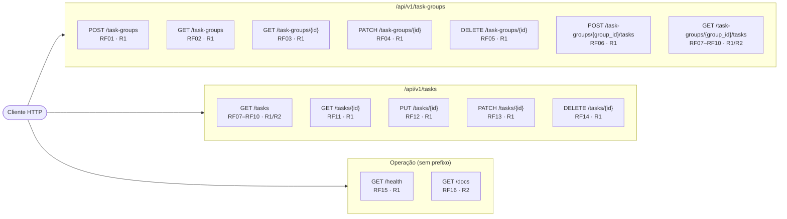
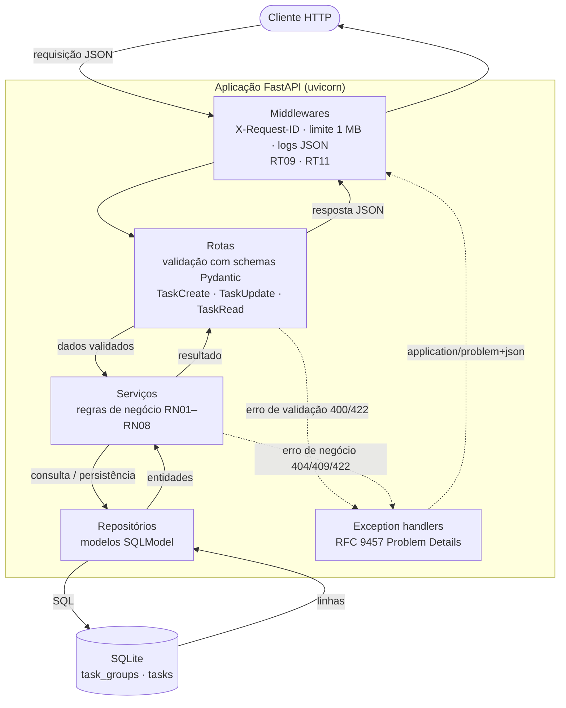
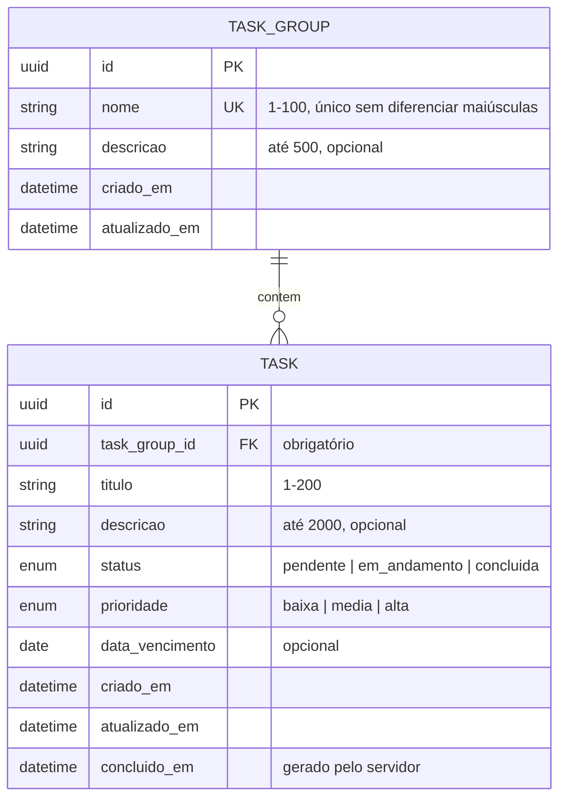
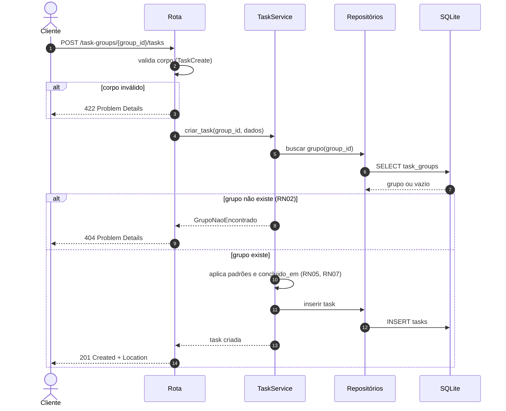
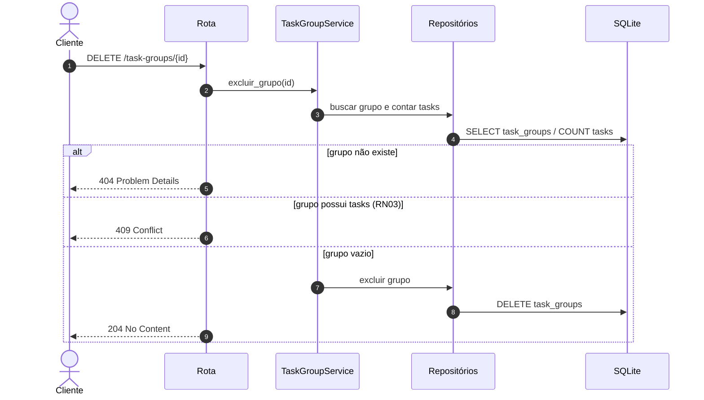
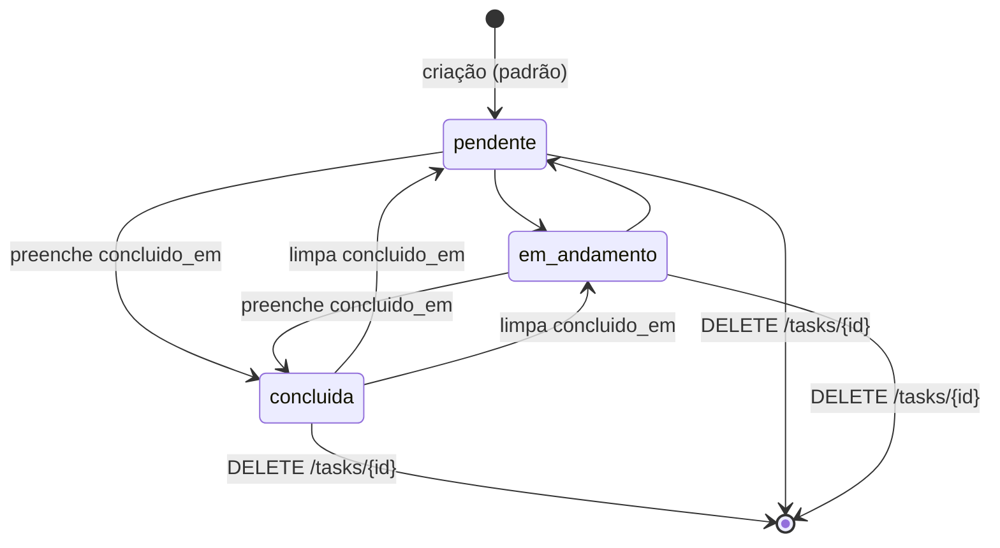

# Diagramas — Endpoints e Fluxo de Dados

| Item | Valor |
|---|---|
| Base | [02-backlog.md](02-backlog.md) v1.0 · [03-arquitetura-mvp.md](03-arquitetura-mvp.md) v1.0 |
| Versão do documento | 1.0 |
| Data | 2026-10-17 |

Os diagramas usam [Mermaid](https://mermaid.js.org/) e são renderizados direto no GitHub, GitLab e VS Code (com extensão de preview Mermaid). Caminhos de negócio são relativos a `/api/v1`.

## 1. Endpoints REST

Endpoints agrupados por recurso, com o ID do requisito e a release em que entram (R1 Core, R2 Piloto).

## 2. Arquitetura em camadas e fluxo de dados

Caminho de uma requisição pelas camadas definidas no RT02. Os schemas Pydantic ficam na borda HTTP; os modelos SQLModel, só no repositório.

## 3. Modelo de dados

## 4. Fluxos principais

### 4.1 Criar tarefa em um grupo (RF06, RN02)

### 4.2 Excluir grupo (RF05, RN03)

### 4.3 Ciclo de vida do status da tarefa (RN06, RN07)

